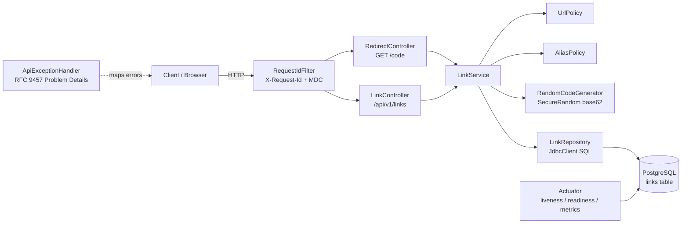
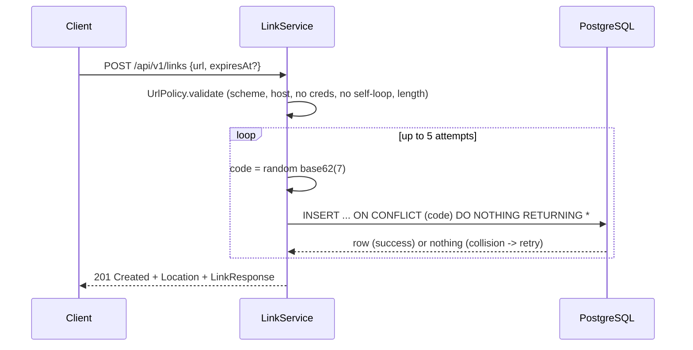
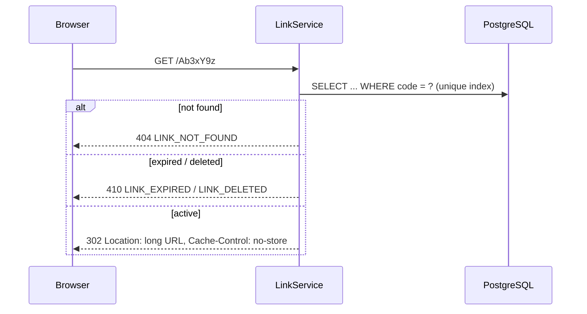

# Architecture overview

> **Living document.** Updated at the end of each phase. Current as of **Phase 1**.

## 1. What the system does
A URL shortener has two jobs:

1. **Create:** turn a long URL into a short code (`POST /api/v1/links`).
2. **Redirect:** send anyone who opens `/{code}` to the long URL (`GET /{code}` returns 302).

Redirects are the **hot path**. In real shorteners they outnumber creates by 100:1 or more, so
the design optimises for fast, always-available reads.

## 2. Components (Phase 1)



| Package | Responsibility |
|---|---|
| `com.shortener.api` | HTTP only: request/response DTOs, controllers, error mapping. No business rules. |
| `com.shortener.link` | Domain: `Link`, use cases (`LinkService`), policies, code generation, persistence. No HTTP types. |
| `com.shortener.config` | Typed, validated configuration (`AppProperties`) and the injectable `Clock`. |
| `com.shortener.web` | Cross-cutting servlet concerns (request id correlation). |

**Dependency rule:** `api → link → (DB)`. The domain never imports from `api`, so the HTTP layer
could be replaced (gRPC, messaging) without touching business logic. Domain exceptions carry meaning;
only `ApiExceptionHandler` knows their HTTP status.

## 3. Data model

```sql
links (
  id           BIGINT IDENTITY PK,          -- internal only, never exposed
  code         VARCHAR(32)  UNIQUE NOT NULL, -- case-sensitive; CHECK '^[A-Za-z0-9_-]{3,32}$'
  long_url     TEXT         NOT NULL,
  custom_alias BOOLEAN      NOT NULL,
  created_at   TIMESTAMPTZ  NOT NULL,
  expires_at   TIMESTAMPTZ  NULL,           -- CHECK expires_at > created_at
  deleted_at   TIMESTAMPTZ  NULL            -- soft delete; code never reused
)
INDEX ix_links_live_id_desc ON links(id DESC) WHERE deleted_at IS NULL   -- list pagination
```
The `UNIQUE(code)` constraint is the uniqueness guarantee (ADR-0003). The redirect lookup uses
its backing index.

## 4. Request flows

**Create (generated code)**


**Redirect**


## 5. API summary

| Method & path | Purpose | Success | Notable errors |
|---|---|---|---|
| `POST /api/v1/links` | Create `{url, alias?, expiresAt?}` | 201 + `Location` | 400 invalid, 409 alias taken, 503 exhausted / DB down |
| `GET /api/v1/links/{code}` | Link details (incl. `status`) | 200 | 404 |
| `GET /api/v1/links?limit=&cursor=` | List live links, newest first | 200 `{items, nextCursor}` | 400 bad limit/cursor |
| `DELETE /api/v1/links/{code}` | Soft delete (idempotent) | 204 | 404 never existed |
| `GET /{code}` (and `HEAD`) | Redirect | 302 | 404 unknown, 410 expired/deleted |
| `GET /actuator/health/{liveness,readiness}` | Probes | 200 | 503 when not ready |

## 6. Reliability properties (Phase 1)

| Concern | Mechanism |
|---|---|
| Duplicate codes, including under concurrency | DB `UNIQUE` + `ON CONFLICT DO NOTHING`; no check-then-insert races |
| Bad input reaching the DB | Bean Validation (shape), then domain policies (rules), then DB `CHECK` constraints |
| DB outage | Hikari 3s connection timeout (fail fast); 503 + `Retry-After`; readiness probe goes DOWN |
| Restart storms during DB outage | Liveness deliberately excludes the DB |
| Deploys | Graceful shutdown: in-flight requests finish (20s budget) |
| Debuggability | `X-Request-Id` on every response and every log line; JSON logs (ECS) in containers |
| Misconfiguration | `AppProperties` is validated at startup, so bad config fails fast |
| Schema drift | Flyway versioned migrations; app never auto-generates DDL |

## 7. What's next
- **Phase 2 (brownfield):** click analytics added to the running system without slowing
  redirects or breaking existing clients.
- **Phase 3 (ambiguous):** an under-specified requirement, taken from interpretation to delivery.
