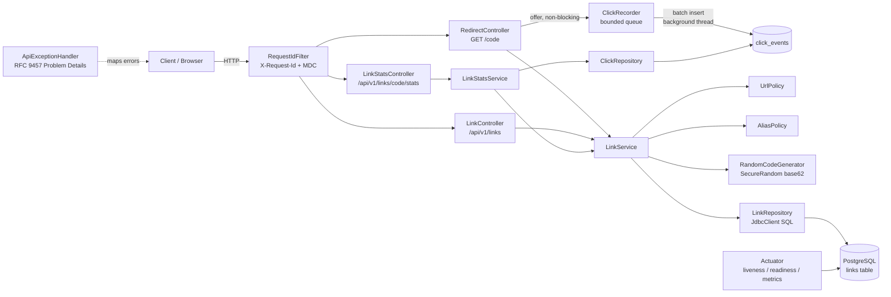
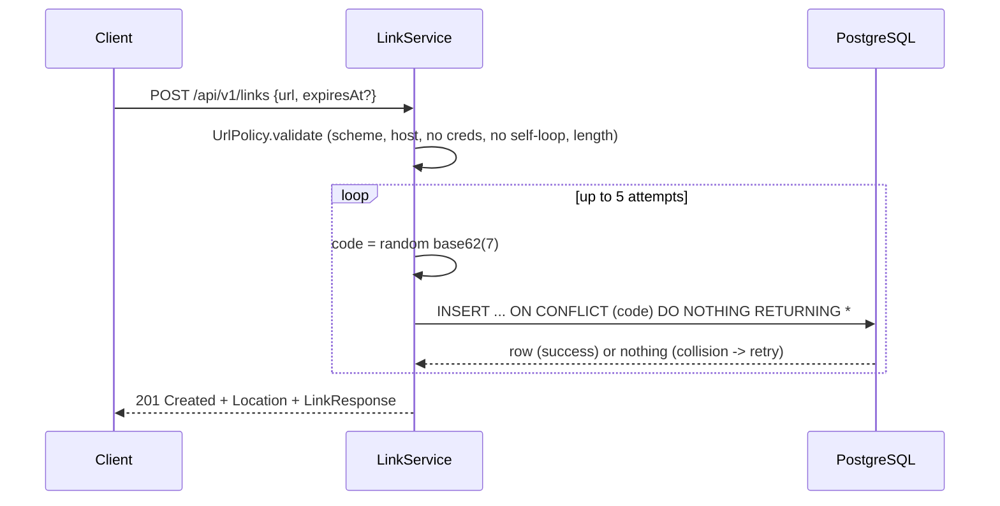

# Architecture overview

> **Living document.** Updated at the end of each phase. Current as of **Phase 2**.

## 1. What the system does
A URL shortener has two core jobs, plus analytics (since Phase 2):

1. **Create:** turn a long URL into a short code (`POST /api/v1/links`).
2. **Redirect:** send anyone who opens `/{code}` to the long URL (`GET /{code}` returns 302).
3. **Analytics:** count each redirect and report clicks over time, referrers and client types
   (`GET /api/v1/links/{code}/stats`).

Redirects are the **hot path**. In real shorteners they outnumber creates by 100:1 or more, so
the design optimises for fast, always-available reads.

## 2. Components



| Package | Responsibility |
|---|---|
| `com.shortener.api` | HTTP only: request/response DTOs, controllers, error mapping. No business rules. |
| `com.shortener.link` | Domain: `Link`, use cases (`LinkService`), policies, code generation, persistence. No HTTP types. |
| `com.shortener.analytics` | Click capture (`ClickRecorder`, `ClickClassifier`) and stats (`LinkStatsService`, `ClickRepository`). Depends on `link`, never the reverse. |
| `com.shortener.config` | Typed, validated configuration (`AppProperties`, `AnalyticsProperties`) and the injectable `Clock`. |
| `com.shortener.web` | Cross-cutting servlet concerns (request id correlation). |

**Dependency rule:** `api → analytics → link → (DB)`. The domain never imports from `api`, so the HTTP layer
could be replaced (gRPC, messaging) without touching business logic. Domain exceptions carry meaning;
only `ApiExceptionHandler` knows their HTTP status.

## 3. Data model

```sql
links (
  id           BIGINT IDENTITY PK,          -- internal only, never exposed
  code         VARCHAR(32)  UNIQUE NOT NULL, -- case-sensitive; CHECK '^[A-Za-z0-9_-]{3,32}$'
  long_url     TEXT         NOT NULL,
  custom_alias BOOLEAN      NOT NULL,
  created_at   TIMESTAMPTZ  NOT NULL,
  expires_at   TIMESTAMPTZ  NULL,           -- CHECK expires_at > created_at
  deleted_at   TIMESTAMPTZ  NULL            -- soft delete; code never reused
)
INDEX ix_links_live_id_desc ON links(id DESC) WHERE deleted_at IS NULL   -- list pagination
```
```sql
click_events (                               -- Phase 2, migration V2 (ADR-0007)
  id            BIGINT IDENTITY PK,
  link_id       BIGINT       NOT NULL FK -> links(id),
  clicked_at    TIMESTAMPTZ  NOT NULL,
  referrer_host VARCHAR(255) NULL,          -- host only; never the path or query
  agent_class   VARCHAR(16)  NOT NULL       -- CHECK IN (DESKTOP, MOBILE, BOT, UNKNOWN)
)
INDEX ix_click_events_link_time ON click_events(link_id, clicked_at)    -- every stats query
```
The `UNIQUE(code)` constraint is the uniqueness guarantee (ADR-0003). The redirect lookup uses
its backing index. No IP addresses or raw User-Agents are stored (ADR-0007).

## 4. Request flows

**Create (generated code)**


**Redirect (with click capture)**
```mermaid
sequenceDiagram
    participant B as Browser
    participant S as LinkService
    participant Q as ClickRecorder queue
    participant W as Writer thread
    participant DB as PostgreSQL
    B->>S: GET /Ab3xY9z
    S->>DB: SELECT ... WHERE code = ?  (unique index)
    alt not found
        S-->>B: 404 LINK_NOT_FOUND
    else expired / deleted
        S-->>B: 410 LINK_EXPIRED / LINK_DELETED
    else active
        S->>Q: offer(click)  (in memory, never blocks; dropped + counted if full)
        S-->>B: 302 Location: long URL, Cache-Control: no-store
    end
    Note over W,DB: asynchronously, off the request path
    W->>Q: poll + drainTo(batch, 500)
    W->>DB: batch INSERT INTO click_events
```
Only successful `GET` redirects are clicks. `HEAD` (link checkers) and 404/410 are not counted.

## 5. API summary

| Method & path | Purpose | Success | Notable errors |
|---|---|---|---|
| `POST /api/v1/links` | Create `{url, alias?, expiresAt?}` | 201 + `Location` | 400 invalid, 409 alias taken, 503 exhausted / DB down |
| `GET /api/v1/links/{code}` | Link details (incl. `status`) | 200 | 404 |
| `GET /api/v1/links?limit=&cursor=` | List live links, newest first | 200 `{items, nextCursor}` | 400 bad limit/cursor |
| `DELETE /api/v1/links/{code}` | Soft delete (idempotent) | 204 | 404 never existed |
| `GET /api/v1/links/{code}/stats?days=` | Click stats: total, last click, daily series (UTC), top referrers, client types | 200 | 404 unknown/deleted, 400 bad `days` (1–365) |
| `GET /{code}` (and `HEAD`) | Redirect | 302 | 404 unknown, 410 expired/deleted |
| `GET /actuator/health/{liveness,readiness}` | Probes | 200 | 503 when not ready |

## 6. Reliability properties

| Concern | Mechanism |
|---|---|
| Duplicate codes, including under concurrency | DB `UNIQUE` + `ON CONFLICT DO NOTHING`; no check-then-insert races |
| Bad input reaching the DB | Bean Validation (shape), then domain policies (rules), then DB `CHECK` constraints |
| DB outage | Hikari 3s connection timeout (fail fast); 503 + `Retry-After`; readiness probe goes DOWN |
| Restart storms during DB outage | Liveness deliberately excludes the DB |
| Deploys | Graceful shutdown: in-flight requests finish (20s budget) |
| Debuggability | `X-Request-Id` on every response and every log line; JSON logs (ECS) in containers |
| Misconfiguration | `AppProperties` is validated at startup, so bad config fails fast |
| Schema drift | Flyway versioned migrations; app never auto-generates DDL |
| Analytics slowing or breaking redirects | Request thread only does an in-memory `offer`; `record()` cannot throw; writer failures are caught (ADR-0006) |
| Analytics overload | Bounded buffer (10,000): excess clicks are dropped and counted, never queued without limit |
| Clicks lost on deploy | Recorder stops after the web server has drained, then flushes; verified under load |
| Pipeline visibility | `shortener.clicks{outcome=recorded/dropped_buffer_full/dropped_write_failed}`, `shortener.clicks.pending` |
| Risky schema change | Expand-only V2 with `lock_timeout`; Phase 1 build still starts against V2 (rollback-safe, ADR-0007) |
| Feature misbehaving in production | Kill switch `APP_ANALYTICS_ENABLED=false`; redirects unaffected |

## 7. What's next
- **Phase 3 (ambiguous):** an under-specified requirement, taken from interpretation to delivery.
- Analytics scaling triggers (rollups, retention, durable pipeline) are in IMPROVEMENTS.md (IMP-015 to IMP-017).
